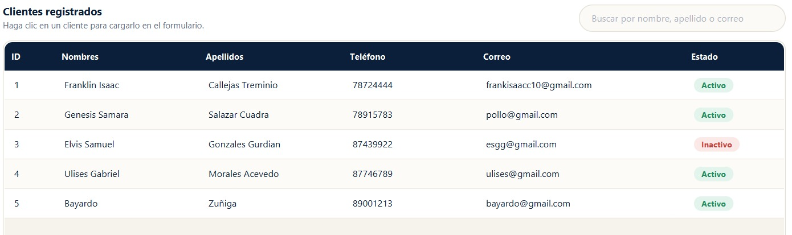
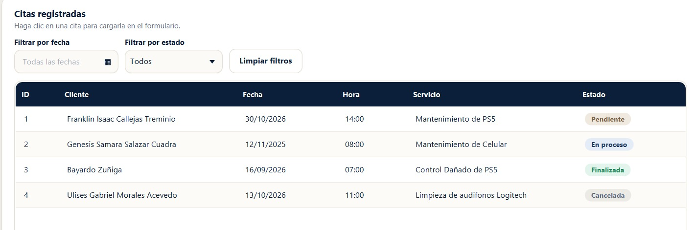
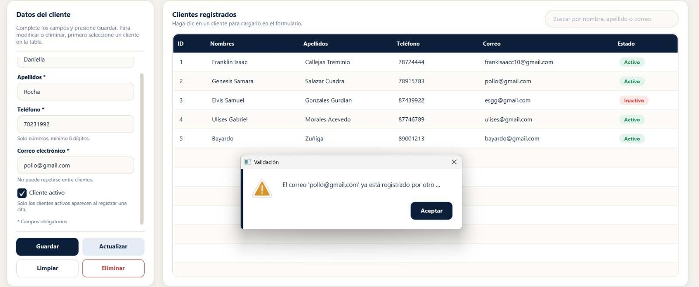
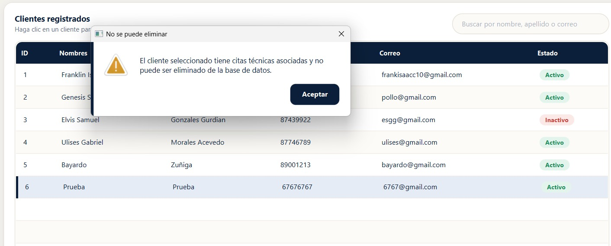

# Evaluacion_JavaFX_CitasTecnicas

Sistema de gestión de citas de atención técnica para **TecnoAsistencia Nicaragua S.A.**, desarrollado con **JavaFX** y conectado a **PostgreSQL** mediante **JDBC** (sin ORM).

**Universidad Americana (UAM)** · Programación de Aplicaciones de Escritorio · Unidad II: Acceso a bases de datos
**Docente:** José A. Durán García

---

## Integrantes y responsabilidades

| Integrante | Usuario GitHub | Responsabilidades |
|---|---|---|
| Franklin Isaac Callejas Treminio | [@FICT1](https://github.com/FICT1) | Creación del repositorio y estructura del proyecto, dependencia JDBC en `pom.xml`, conexión centralizada (`DatabaseConnection`), `AlertUtil`, ventana principal (`MainView` / `MainController`), script `gestion_citas.sql` y configuración de credenciales locales. |
| Daris Dayana Mayorga Oyes | [@darismayorga](https://github.com/darismayorga) | Módulo de clientes: modelo `Cliente`, `ClienteDAO` (CRUD y búsqueda), `ClienteController` y `ClienteView.fxml`. |
| Luis Xavier Aburto Mantilla | [@LXaburtoM](https://github.com/LXaburtoM) | Módulo de citas técnicas: modelo `CitaTecnica`, `CitaTecnicaDAO` (CRUD con JOIN), `CitaController` y `CitaView.fxml`, reestructuración de `AlertUtil`. |
| Daniella Alexandra Rocha Palacios | [@vybdani](https://github.com/vybdani) | Diseño completo de la interfaz gráfica (vistas FXML y estilos), validaciones (`ValidacionUtil`, correo con formato y sin duplicados, longitudes, estados permitidos), manejo de `SQLException` con mensajes comprensibles, filtrado de citas con `PreparedStatement`, actualización de tablas y ComboBox sin reiniciar, correcciones generales y README. |

---

## Requisitos

| Herramienta | Versión |
|---|---|
| JDK | 21 |
| PostgreSQL | Versión reciente (el driver JDBC 42.7 es compatible con PostgreSQL 8.4 o superior) |
| IntelliJ IDEA | Community o Ultimate |
| Maven | Incluido en el proyecto (`mvnw` / `mvnw.cmd`) |

Dependencias principales (descargadas automáticamente por Maven):

- `org.openjfx:javafx-controls` y `javafx-fxml` 21.0.6
- `org.postgresql:postgresql` 42.7.2 (driver JDBC)

---

## Instalación y ejecución

### 1. Clonar el repositorio

```bash
git clone https://github.com/FICT1/Evaluacion_JavaFX_CitasTecnicas.git
cd Evaluacion_JavaFX_CitasTecnicas
```

### 2. Crear la base de datos

1. Abrir pgAdmin o `psql` con el usuario `postgres`.
2. Crear la base de datos `gestion_citas`.
3. Ejecutar el script `gestion_citas.sql` sobre esa base para crear las tablas `cliente` y `cita_tecnica` con su relación.

```bash
psql -U postgres -c "CREATE DATABASE gestion_citas;"
psql -U postgres -d gestion_citas -f gestion_citas.sql
```

### 3. Configurar las credenciales locales

La conexión está centralizada en `src/main/java/ni/edu/uam/evaluacion_javafx_citastecnicas/util/DatabaseConnection.java`, con estos valores:

| Parámetro | Valor |
|---|---|
| URL | `jdbc:postgresql://localhost:5432/gestion_citas` |
| Usuario | `postgres` |
| Contraseña | la contraseña local de cada integrante |

> **Pendiente:** documentar aquí el mecanismo final de credenciales locales. Las contraseñas reales no deben subirse al repositorio.

### 4. Ejecutar la aplicación

**Desde IntelliJ IDEA:**

1. Abrir la carpeta del proyecto (IntelliJ detecta el `pom.xml` y descarga las dependencias).
2. Si se pide, recargar Maven: panel **Maven** → *Reload All Maven Projects*.
3. Ejecutar la clase `Launcher` (`src/main/java/ni/edu/uam/evaluacion_javafx_citastecnicas/Launcher.java`).

**Desde la terminal:**

```bash
./mvnw clean javafx:run
```

En Windows (cmd o PowerShell): `mvnw.cmd clean javafx:run`

La barra inferior de la ventana indica si la conexión con PostgreSQL fue exitosa.

---

## Modelo de datos

Base de datos `gestion_citas`, con relación **cliente (1) — (N) cita_tecnica**.

**cliente**

| Campo | Tipo | Reglas |
|---|---|---|
| id | INT | PK, autoincremental |
| nombres | VARCHAR(80) | NOT NULL |
| apellidos | VARCHAR(80) | NOT NULL |
| telefono | VARCHAR(20) | NOT NULL |
| correo | VARCHAR(120) | NOT NULL, UNIQUE |
| activo | BOOLEAN | NOT NULL |

**cita_tecnica**

| Campo | Tipo | Reglas |
|---|---|---|
| id | INT | PK, autoincremental |
| cliente_id | INT | NOT NULL, FK a `cliente.id` |
| fecha | DATE | NOT NULL |
| hora | TIME | NOT NULL |
| tipo_servicio | VARCHAR(80) | NOT NULL |
| descripcion | VARCHAR(255) | NOT NULL |
| estado | VARCHAR(20) | NOT NULL: Pendiente, En proceso, Finalizada o Cancelada |

Eliminar significa **eliminación física**. No se permite eliminar un cliente con citas asociadas.

---

## Estructura del proyecto

```
src/main/java/ni/edu/uam/evaluacion_javafx_citastecnicas/
├── Launcher.java              Punto de entrada
├── MainApp.java               Carga la ventana principal
├── controller/
│   ├── MainController.java    Estado de la conexión y cambio de pestañas
│   ├── ClienteController.java CRUD, búsqueda y validaciones de clientes
│   └── CitaController.java    CRUD, filtros y validaciones de citas
├── dao/
│   ├── ClienteDAO.java        SQL de la tabla cliente
│   └── CitaTecnicaDAO.java    SQL de la tabla cita_tecnica (JOIN con cliente)
├── model/
│   ├── Cliente.java
│   └── CitaTecnica.java
└── util/
    ├── DatabaseConnection.java Conexión JDBC centralizada
    ├── AlertUtil.java          Alertas reutilizables
    └── ValidacionUtil.java     Reglas de validación
src/main/resources/ni/edu/uam/evaluacion_javafx_citastecnicas/
├── MainView.fxml              Ventana principal con pestañas
├── ClienteView.fxml           Formulario y tabla de clientes
└── CitaView.fxml              Formulario, filtros y tabla de citas
```

---

## Funcionalidades

| Código | Funcionalidad | Implementación |
|---|---|---|
| RF01 | Conexión JDBC centralizada y manejo de errores | `DatabaseConnection.getConnection()` y `probarConexion()`; el estado se muestra en la barra inferior |
| RF02 | CRUD de clientes con formulario y TableView | `ClienteController` + `ClienteDAO` |
| RF03 | CRUD de citas; cliente elegido en ComboBox | `CitaController` + `CitaTecnicaDAO`; el ComboBox lista clientes activos |
| RF04 | Tabla de citas con ID, cliente, fecha, hora, servicio y estado | Consulta con `INNER JOIN` entre `cita_tecnica` y `cliente` |
| RF05 | Búsqueda parcial de clientes sin distinguir mayúsculas | `ClienteDAO.buscar()` con `LOWER(...) LIKE ?` sobre nombres, apellidos y correo |
| RF06 | Filtros de citas por estado y fecha, con opción de limpiarlos | `CitaTecnicaDAO.filtrar()` con `PreparedStatement`; botón "Limpiar Filtros" |
| RF07 | Validaciones | `ValidacionUtil`: obligatorios, longitudes, formato de correo y teléfono; correo duplicado (`ClienteDAO.existeCorreo()`); fecha, hora, cliente existente y estado permitido |
| RF08 | Confirmación al eliminar y alertas claras | `AlertUtil`; mensajes específicos para correo duplicado (SQLState 23505), cliente inexistente (23503) y cliente con citas |
| RF09 | Tablas actualizadas sin reiniciar | Recarga tras cada operación, al desplegar el ComboBox y al entrar a la pestaña de citas |
| RF10 | Persistencia en PostgreSQL | Todas las operaciones se ejecutan directamente sobre la base de datos |

---

## Uso de JDBC

| Clase JDBC | Dónde se usa |
|---|---|
| `Connection` | `DatabaseConnection.getConnection()`, usada por todos los DAO |
| `Statement` | `DatabaseConnection.probarConexion()` ejecuta `SELECT 1` (sentencia fija, sin datos del usuario) |
| `PreparedStatement` | Todas las inserciones, actualizaciones, eliminaciones, búsquedas y filtros, siempre con parámetros `?` |
| `ResultSet` | Lectura de resultados en `listar()`, `buscar()`, `filtrar()`, `existeCorreo()` y `tieneCitasAsociadas()` |

- Conexiones, sentencias y resultados se cierran con **try-with-resources**.
- Ningún texto ingresado por el usuario se concatena en el SQL.
- Los DAO propagan `SQLException` y los controladores la muestran con un mensaje comprensible.

**Flujo general:** el usuario actúa en la vista (FXML) → el controlador valida los datos y construye el objeto del modelo → el DAO abre la conexión, ejecuta el `PreparedStatement` y devuelve objetos del modelo → el controlador actualiza la `TableView` y muestra la alerta correspondiente.

---

## Pruebas de aceptación

- [ ] Registrar un cliente y comprobar su aparición en la TableView.
- [ ] Intentar registrar un correo repetido y comprobar el rechazo con un mensaje.
- [ ] Modificar el teléfono del cliente y comprobar que el cambio persiste.
- [ ] Registrar una cita asociada a ese cliente y ver su nombre en la TableView.
- [ ] Buscar por una parte del apellido y comprobar los resultados.
- [ ] Filtrar citas por estado y fecha, y limpiar los filtros.
- [ ] Cambiar el estado de una cita a Finalizada.
- [ ] Intentar eliminar un cliente con citas; la operación debe rechazarse.
- [ ] Eliminar la cita y después el cliente, confirmando cada operación.
- [ ] Cerrar y volver a abrir la aplicación y comprobar que los cambios persisten.

---

## Capturas de funcionamiento

### Gestión de clientes

Listado de clientes con su estado (activo / inactivo).



### Gestión de citas técnicas

Listado de citas con el nombre del cliente, filtros por fecha y estado, y los cuatro estados permitidos.



### Validación de correo duplicado

Al registrar un cliente con un correo que ya existe, la aplicación rechaza la operación y explica el motivo.



### Eliminación restringida

No se permite eliminar un cliente que tiene citas asociadas; la aplicación explica el motivo.


